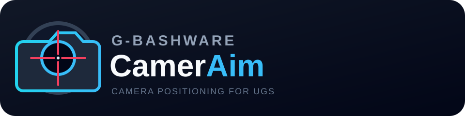

<p align="center">
  
</p>

# G-BASHWARE CamerAim

G-BASHWARE CamerAim is a camera positioning plugin for [Universal Gcode Sender Platform](https://github.com/winder/Universal-G-Code-Sender). It places a precise crosshair over a live USB camera image and moves the CNC tool from the camera target to the calibrated tool position.

The current release targets **UGS Platform 2.1.6** and **Java 17 or newer**. The camera connects directly to the computer running UGS.

The published UGS plugin is **v2.2.0**. Development of the local monitoring
system now lives in the same repository:

- shared/ — versioned API v1 contract and fixtures
- server/ — ASP.NET Core/.NET 10 local server with SQLite
- simulator/ — deterministic CNC job and retry simulator
- android-app/ — Kotlin/Jetpack Compose monitoring prototype

These monitoring components are pre-release companion services.

## Features

- Windows camera discovery and live preview through the MediaCapture API
- Resolutions populated from the selected camera's actual Windows-reported formats
- Selectable 5, 10, 15, 20, 25, and 30 FPS preview limits with exact output-resolution verification
- Camera capture isolated from UGS so a failed or crashed camera helper cannot terminate UGS
- Exact output-resolution verification and copyable camera diagnostics
- Centered 1×, 2×, and 3× digital zoom
- 0°, 90°, 180°, and 270° clockwise display rotation
- Crosshair with an uncovered 3 × 3 pixel opening at its exact center
- Persistent X/Y camera-to-tool offset, units, and jog feed
- Exact relative XY movement from the crosshair target to the tool
- Live machine coordinates and calculated tool target
- A separate command to set the current work X/Y zero
- Aim Height: rehome Z to maximum height and lower by a configurable distance (default 50 mm) for consistent optical focal distance
- Movement lockout unless UGS is connected, Idle, and able to jog
- Built-in G-BASHWARE update-center registration

Version 2.2.0 requires Windows 10 or 11. It no longer loads the legacy OpenIMAJ/videoInput native camera library into UGS.

## Install

1. Download the latest `G-BASHWARE-CamerAim-2.2.0_for-UGS-2.1.6.nbm` from [Releases](https://github.com/bash-ware/G-BASHWARE-CamerAim/releases/latest).
2. In UGS Platform, open **Tools → Plugins → Downloaded**.
3. Choose **Add Plugins**, select the `.nbm` file, and complete the installer.
4. Restart UGS if requested.
5. Open **Window → Plugins → G-BASHWARE CamerAim** if the panel is not already visible.

The first installed release registers the G-BASHWARE CamerAim update center. Later tagged releases are then available through the UGS plugin manager.

See [Installation and calibration](docs/INSTALL.md) for the offset convention and first-machine test procedure.

## Camera-to-tool offset

Place a reference mark under the crosshair. Enter the relative move the tool must make to reach that mark. The plugin sends the entered signs exactly as shown:

- `X +12.000 mm` moves the tool 12 mm in positive X.
- `Y -3.500 mm` moves the tool 3.5 mm in negative Y.

Raise Z to a verified safe height and check the full XY path before accepting the movement dialog. CamerAim never starts the spindle and never changes Z.

## Build

The repository keeps UGS source and local Maven artifacts out of Git. On Windows, prepare `.upstream/ugs` and `.m2/repository`, then run:

```powershell
.\build.ps1
```

GitHub Actions performs the complete clean build against the UGS 2.1.6 source and distribution. Every push and pull request runs the tests. A `v*` tag creates the NBM, an installer ZIP, checksums, a GitHub Release, and the NetBeans update-center catalog.

The local server requires the .NET 10 SDK:

~~~powershell
dotnet build server/CamerAim.Server.csproj
dotnet run --project server/CamerAim.Server.csproj
dotnet run --project simulator/CamerAim.Simulator.csproj
~~~

Android build requirements and device-test limitations are documented in
[android-app/README.md](android-app/README.md). The shared wire contract is in
[shared/README.md](shared/README.md).

## Roadmap

Planned and in-progress work includes:

- live job duration, elapsed time, remaining time, feed, and progress
- the local monitoring server and Android notifications without ntfy or Firebase
- G-code toolpath overlay on the camera image
- automatic full-table image capture by moving through a calibrated grid
- lens-distortion calibration, cropping, and image stitching similar to LightBurn camera calibration

The detailed working plan is in [PLAN-UGS-plugin.md](PLAN-UGS-plugin.md).

## License

Copyright © 2026 G-BASHWARE. Licensed under the [GNU General Public License v3.0](COPYING).
